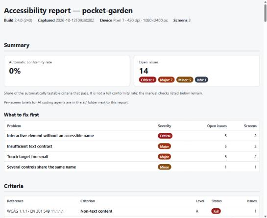
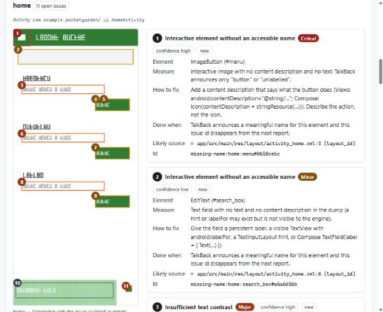

# a11y-report

**Accessibility audit for Android apps, from your terminal.** Run `a11y-report` at the root of an
Android project with a phone (or emulator) connected: it guides you through capturing the screens
of your app, then writes a report with:

- **`report.html`**: a self-contained, accessible report for humans. The first page summarizes
  the automatic conformity rate, open issues by severity, what to fix first and the status of each
  WCAG / EN 301 549 criterion. Then comes a screen-by-screen detail with annotated screenshots.
- **`ai/*.md`**: one brief per screen for AI coding agents (Claude Code, Cursor, Copilot…). Each
  issue comes with its measured evidence, the likely source file and line, the fix, and how to
  check that it is done.
- **`report.json`**: the source of truth for CI, diffs and tools. It is deterministic and follows a
  published [JSON Schema](schema/report.v1.json).




The engine is written in Rust. It is deterministic (same input, same bytes out) and works offline,
with no telemetry. It analyses 100 screens in about 0.5 s.

> 🇫🇷 Une [section en français](#en-français) se trouve en bas de page. The tool itself speaks both
> languages: add `--lang fr` to any command.

---

## Contents

- [Install](#install)
- [Quick start](#quick-start)
- [What is checked](#what-is-checked)
- [Commands](#commands)
- [Use it in CI](#use-it-in-ci)
- [Configuration (`a11y.toml`)](#configuration-a11ytoml)
- [Working with an AI agent](#working-with-an-ai-agent)
- [Output format](#output-format)
- [Known limitations](#known-limitations)
- [Architecture and development](#architecture-and-development)
- [En français](#en-français)

## Install

### Prebuilt binaries (recommended)

**macOS / Linux**

```bash
curl -fsSL https://raw.githubusercontent.com/clemPerrousset/a11y-report/main/install.sh | sh
```

**Windows (PowerShell)**

```powershell
irm https://raw.githubusercontent.com/clemPerrousset/a11y-report/main/install.ps1 | iex
```

The scripts download the latest release for your platform from
[GitHub Releases](https://github.com/clemPerrousset/a11y-report/releases):

| Platform | Archive |
|---|---|
| Linux x86_64 / arm64 | `a11y-report-x86_64-unknown-linux-gnu.tar.gz` / `a11y-report-aarch64-unknown-linux-gnu.tar.gz` |
| macOS Intel / Apple Silicon | `a11y-report-x86_64-apple-darwin.tar.gz` / `a11y-report-aarch64-apple-darwin.tar.gz` |
| Windows x86_64 | `a11y-report-x86_64-pc-windows-msvc.zip` |

You can also download an archive by hand, extract it and put `a11y-report` (or
`a11y-report.exe`) somewhere on your `PATH`. Every release lists its `SHA256SUMS.txt`.

### With Cargo

You need Rust 1.88 or newer ([rustup.rs](https://rustup.rs)).

```bash
cargo install a11y-report-cli
```

Or install the latest development version straight from GitHub:

```bash
cargo install --git https://github.com/clemPerrousset/a11y-report a11y-report-cli
```

Both install the `a11y-report` command.

### From source

```bash
git clone https://github.com/clemPerrousset/a11y-report
cd a11y-report
cargo build --release
./target/release/a11y-report --version
```

### Requirements for capturing screens

- **adb** (Android platform-tools). If Android Studio is installed, `a11y-report` finds it
  automatically through `local.properties`, `ANDROID_HOME` or the default SDK location. Otherwise,
  install [platform-tools](https://developer.android.com/tools/releases/platform-tools) and add
  them to your `PATH`.
- A phone with **USB debugging** enabled (Settings → Developer options), or a running emulator.
- Your app installed on that device, in **portrait** mode.

Run `a11y-report doctor` to check everything.

## Quick start

Try it without a device first. This creates a small fictional project ("Pocket Garden") and its
report:

```bash
a11y-report demo
```

Open `a11y-demo/a11y-report/report.html`.

On your own app, open a terminal **at the root of the Android project** (the folder containing
`settings.gradle(.kts)`), connect the phone, then run:

```bash
a11y-report
```

1. The tool detects the project and its `applicationId`, finds adb, and selects the device.
2. On the phone, open the screen you want to audit. In the terminal, press **Enter** to capture it
   (or type a name such as `checkout` first). The name suggested by default comes from the current
   activity.
3. Repeat for every screen, then type **`q`** and press Enter.
4. The report is written to `./a11y-report/`:

```
a11y-report/
├── report.html          ← open this
├── report.json
├── ai/
│   ├── README.md        ← instructions + summary for AI agents
│   ├── home.md
│   └── checkout.md
└── run/                 ← the captures (run.json, screens/*.xml, screens/*.png)
```

The terminal shows a 3-line summary:

```
Automatic conformity rate: 60% (+20 pts vs 2.3.0 (230))
Issues: 1 critical · 4 major · 6 minor · 2 info — 2 new, 3 fixed
Report: /path/to/app/a11y-report/report.html
```

Next time you run it, the previous `report.json` becomes the baseline automatically. Issues are
tracked as **new**, **existing** or **fixed** (ids are stable across builds), and the screens you
did not capture again are listed as **not rechecked**, never as fixed.

Useful options:

```bash
a11y-report --lang fr          # report and messages in French
a11y-report --launch           # start the app before capturing
a11y-report --append           # keep previous captures and add new screens
a11y-report --serial emulator-5554 --package com.example.app
```

## What is checked

| Rule | What it detects | Criteria | Severity |
|---|---|---|---|
| `missing-name` | Interactive element with no accessible name (no content description, no text, no named child) | WCAG 4.1.2 (EN 301 549 11.4.1.2); 1.1.1 for images | critical for image buttons, major otherwise, minor for text fields (low confidence) |
| `target-size` | Touch targets smaller than 24 dp (WCAG 2.5.8) or 48 dp (Android guideline) | WCAG 2.5.8; Android 48 dp guideline | major below 24 dp, minor below 48 dp |
| `contrast-text` | Text contrast measured on the screenshot (text and background colours extracted per element) | WCAG 1.4.3 (EN 301 549 11.1.4.3) | major; info with low confidence on images and gradients |
| `duplicate-name` | Several controls on a screen announced with the same name (e.g. 10 "Join" buttons) | WCAG 2.4.6 (EN 301 549 11.2.4.6) | minor |

Every issue carries its **measured evidence**: contrast ratio, colours, size in dp, and so on. For
contrast, the report also suggests the closest text colour (same hue) that passes.

The report also lists the criteria that **cannot be checked automatically** (reading order, focus
order, text resizing, captions…) as manual checks. The headline figure is always called the
*automatic* conformity rate: it is not a full conformity assessment.

## Commands

| Command | Purpose |
|---|---|
| `a11y-report` / `a11y-report scan` | Interactive capture over adb, then analysis (default) |
| `a11y-report capture <name>` | Capture the screen currently shown into `a11y-report/run` (for scripts and UI tests) |
| `a11y-report analyze [RUN_DIR]` | Analyse an existing run folder (default `./a11y-report/run`) |
| `a11y-report diff <BASE.json> <HEAD.json>` | Compare two reports without re-analysing |
| `a11y-report rules` | List rules, criteria and parameters |
| `a11y-report schema` | Print the JSON Schema of `report.json` |
| `a11y-report demo [DIR]` | Generate a demo project and report, no device needed |
| `a11y-report doctor` | Check adb, devices and the Android project |

Options shared by `scan` and `analyze`:

```
--out <DIR>                         output folder (default ./a11y-report)
--format json,html,md               files to write (default: all three)
--baseline <REPORT.json>            previous report to compare with
--config <a11y.toml>                default: ./a11y.toml when it exists
--fail-on critical|major|minor|none exit code 1 above this severity (default: major)
--new-only                          only fail on issues that are new vs the baseline
--stdout summary|json|none          what to print on stdout (default: summary)
--project <DIR>                     Android project used to locate source files
--lang en|fr                        language of reports and messages
```

Logs go to stderr (`-v`, `-vv`, or `A11Y_LOG=debug`). Stdout stays clean for pipes.

## Use it in CI

Exit codes:

| Code | Meaning |
|---|---|
| 0 | Analysis done, no open issue at or above `--fail-on` |
| 1 | Analysis done, threshold exceeded (the report is still written) |
| 2 | Invalid input: manifest, XML, image or configuration (the run continues for the other screens) |
| 3 | Unexpected internal error |

Capture screens in your UI tests or on a device farm, either with `a11y-report capture <name>` or
with any tool that writes the [run folder format](#run-folder). Then gate on regressions only:

```bash
a11y-report analyze build/a11y-run \
  --baseline a11y-baseline/report.json \
  --new-only --fail-on major --stdout summary
```

`report.json` can be stored as an artifact and used as the next baseline. Low-confidence findings
and `info` findings never fail a build.

## Configuration (`a11y.toml`)

Put an `a11y.toml` at the root of the project (see [`a11y.toml.example`](a11y.toml.example)):

```toml
[rules.target-size]
enabled = true
min_dp = 48        # below: minor (Android guideline)
hard_min_dp = 24   # below: major (WCAG 2.5.8)

[rules.contrast-text]
severity = "major" # override the default severity

[ignore]
resource_ids = ["*:id/debug_*"]                        # globs on the full resource id
findings = ["contrast-text:home:btn_join#a41f09c2"]    # accepted issues, by id
```

Ignored issues are kept in the JSON with `"ignored": true`, so the audit trail is preserved. They
do not count in the score or in exit codes. Unknown rules or keys are reported as errors (exit
code 2).

## Working with an AI agent

The `ai/` folder is written for coding agents. A typical prompt:

> Read `a11y-report/ai/README.md`, then fix the critical and major issues listed in
> `a11y-report/ai/home.md`. Follow the fix and "done when" of each issue. Do not change anything
> else.

Each issue in `ai/<screen>.md` contains:

- its stable `id`, severity, confidence and status (new or existing);
- the element: class, resource id, text, accessible name and bounds;
- the evidence: contrast ratio and colours, size in dp, duplicate names…;
- the **likely source**: matching layout ids, `testTag`s, ViewBinding fields, `R.id` and `R.string`
  references, or literal texts, with file and line;
- the fix (Views and Compose) and an acceptance test.

After fixing, capture the screens again and re-run `a11y-report`. Fixed issues move to the
"fixed" list.

## Output format

### `report.json`

The full schema is in [`schema/report.v1.json`](schema/report.v1.json) (`a11y-report schema`).
Main fields: `summary` (rate, counts, diff), `criteria` (status per criterion), `screens`,
`issues` (with `evidence` and `source_hints`), `fixed`, `not_rechecked`, `manual_checks`,
`known_limitations`, and `tool.rules_digest` (a hash of the rule versions and configuration).

Issue ids look like `contrast-text:home:btn_water#9b1c03aa`. They do not depend on positions, and
numbers in texts are ignored ("3 participants" ≡ "4 participants"), so the same problem keeps the
same id from one build to the next.

### Run folder

`analyze` reads a run folder. `scan` and `capture` write one, and other tools can produce it too:

```
run/
├── run.json
└── screens/
    ├── home.xml   (adb shell uiautomator dump)
    └── home.png   (adb exec-out screencap -p)
```

```json
{
  "schema": 1,
  "app": "pocket-garden",
  "platform": "android",
  "build": "2.4.0 (240)",
  "captured_at": "2026-10-12T09:30:00Z",
  "package": "com.example.pocketgarden",
  "device": { "model": "Pixel 7", "density_dpi": 420, "width_px": 1080, "height_px": 2400, "font_scale": 1.0 },
  "screens": [
    { "name": "home", "hierarchy": "screens/home.xml", "screenshot": "screens/home.png" }
  ]
}
```

Screen names use `[a-z0-9_-]`. `density_dpi` is required. `screenshot` is optional: without it, the
contrast rule is marked "not verified" for that screen.

## Known limitations

- Only the screens you capture are audited.
- WCAG 2.5.8: the spacing exception is not evaluated.
- Contrast: bold text cannot be detected, so the 14 pt bold rule does not apply. Text over images
  or gradients is reported with low confidence.
- Text fields: `hint` and `labelFor` are not visible in uiautomator dumps, so missing labels on
  `EditText` have low confidence.
- Jetpack Compose only exposes `testTag`s as resource ids when `testTagsAsResourceId` is enabled.
  Without it, issue ids use the structural path of the element.
- Landscape captures are not supported yet.
- iOS, automatic crawling, LLM suggestions, MCP server and SARIF output are on the roadmap.

## Architecture and development

The project is a Cargo workspace (edition 2024). All the logic lives in libraries, and the binary
is a thin layer, so another front end such as an MCP server can reuse it.

| Crate | Role |
|---|---|
| `a11y-report-core` | Model, `Rule` trait, criteria catalog, fingerprints, diff, summary. No I/O |
| `a11y-report-android` | uiautomator parser, `run.json`, adb wrapper, Gradle project detection, source index |
| `a11y-report-rules` | The four rules and the WCAG contrast maths |
| `a11y-report-render` | JSON + JSON Schema, HTML (askama templates), AI briefs, EN/FR labels |
| `a11y-report-cli` | Analysis pipeline (rayon), configuration, capture sessions, the `a11y-report` binary |

```bash
cargo test --workspace                     # unit, property, snapshot, determinism, CLI tests
cargo clippy --workspace --all-targets -- -D warnings
cargo bench -p a11y-report-cli             # 100 screens: ~0.5 s (target < 2 s)
cargo run -p a11y-report-cli -- schema > schema/report.v1.json   # after changing the report model
```

Design decisions are recorded in [`docs/decisions.md`](docs/decisions.md), and the real-device
validation plan is in [`docs/validation.md`](docs/validation.md).

**Releasing**: push a tag `vX.Y.Z`. GitHub Actions builds the binaries for 5 targets, attaches
them to a GitHub release with checksums, and publishes the crates to crates.io when the
`CARGO_REGISTRY_TOKEN` secret is set.

## License

Licensed under either of [Apache License 2.0](LICENSE-APACHE) or [MIT license](LICENSE-MIT), at
your option.

---

## En français

**a11y-report** audite l'accessibilité d'une application Android depuis le terminal.

**Installation**

- macOS / Linux : `curl -fsSL https://raw.githubusercontent.com/clemPerrousset/a11y-report/main/install.sh | sh`
- Windows (PowerShell) : `irm https://raw.githubusercontent.com/clemPerrousset/a11y-report/main/install.ps1 | iex`
- Avec Cargo : `cargo install a11y-report-cli`

**Prérequis** : `adb` (installé avec Android Studio), un téléphone avec le débogage USB activé ou un
émulateur, et l'application installée dessus. Vérifiez avec `a11y-report doctor`.

**Utilisation**

1. Ouvrez un terminal à la racine du projet Android et lancez `a11y-report --lang fr`.
2. Sur le téléphone, ouvrez un écran, puis appuyez sur Entrée dans le terminal pour le capturer.
   Vous pouvez d'abord taper un nom.
3. Recommencez pour chaque écran, puis tapez `q`.
4. Ouvrez `a11y-report/report.html`. La première page est une synthèse lisible par un humain :
   taux de conformité automatique, problèmes par sévérité, priorités et critères WCAG / EN 301 549.
   Suit le détail écran par écran, avec les captures annotées.
5. Le dossier `a11y-report/ai/` contient une fiche par écran destinée aux agents IA : mesure,
   fichier source probable, correction à appliquer et critère de validation.

Sans téléphone, `a11y-report --lang fr demo` génère un projet et un rapport de démonstration.

En CI, `a11y-report analyze <dossier> --baseline ancien/report.json --new-only` renvoie le code 1
seulement en cas de régression. Le rapport précédent sert automatiquement de référence au
lancement suivant : les problèmes sont suivis comme nouveaux, existants ou corrigés.

Le taux affiché est un **taux de conformité automatique** : il ne couvre que les critères
vérifiables automatiquement. Les vérifications manuelles restantes sont listées dans le rapport.
